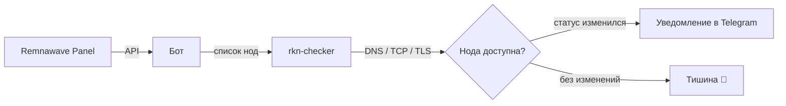

<div align="center">

# 🛡️ Remnawave RKN Monitor Bot

**Telegram-бот для автоматического мониторинга блокировок (ТСПУ/DPI) серверов, управляемых через панель Remnawave**

[](https://www.python.org/)
[](https://www.docker.com/)
[](LICENSE)
[](https://core.telegram.org/bots)

[Возможности](#-возможности) •
[Быстрый старт](#-быстрый-старт-docker) •
[Конфигурация](#%EF%B8%8F-переменные-окружения-env) •
[Команды](#-команды-бота) •
[Как это работает](#-как-это-работает)

</div>

---

## 📖 О проекте

Бот интегрируется с API **Remnawave**, автоматически подтягивает список ваших нод и проверяет их доступность из российской сети с помощью утилиты **rkn-checker**.

Вы узнаете о блокировке раньше, чем о ней сообщат пользователи.

## ✨ Возможности

| | Функция | Описание |
|---|---|---|
| 🔄 | **Синхронизация с Remnawave** | Автоматически забирает список нод, IP-адреса и провайдеров из вашей панели |
| 🕵️ | **Глубокая проверка** | Использует `rkn-block-checker` для анализа DNS, TCP и TLS — выявляет DPI-блокировки |
| 🔔 | **Умные уведомления (Anti-Spam)** | Присылает сообщение только при смене статуса (упал / восстановился). Не спамит, если нода лежит долго |
| 📊 | **Ручные отчёты** | Команда `/check` проводит внеплановую проверку и присылает структурированный отчёт |
| 🔐 | **Безопасность** | Доступ к командам имеют только пользователи, указанные в конфигурации (Middleware) |
| 🐳 | **Docker** | Полная изоляция, простой деплой и обновление |

## 🚀 Быстрый старт (Docker)

**1. Клонируйте репозиторий**

```bash
git clone https://github.com/your-username/remnawave-rkn-monitor.git
cd remnawave-rkn-monitor
```

**2. Настройте переменные окружения**

Скопируйте шаблон и заполните его своими данными:

```bash
cp .env.example .env
nano .env
```

**3. Запустите контейнер**

```bash
docker compose up -d --build
```

**4. Проверьте логи**

```bash
docker compose logs -f
```

## ⚙️ Переменные окружения (`.env`)

| Переменная | Описание | Пример |
|---|---|---|
| `BOT_TOKEN` | Токен вашего бота от [@BotFather](https://t.me/BotFather) | `123456:ABC-DEF...` |
| `ADMIN_IDS` | ID пользователей через запятую (кому разрешён доступ) | `123456789,987654321` |
| `TARGET_THREAD_ID` | ID темы (топика) в рабочей группе *(опционально)* | `1726` |
| `CHECK_INTERVAL_MINUTES` | Интервал проверки нод (в минутах) | `10` |
| `SYNC_INTERVAL_MINUTES` | Интервал синхронизации с Remnawave (в минутах) | `60` |
| `PANEL_URL` | URL вашей панели Remnawave (без `/api`) | `https://status.example.com` |
| `API_TOKEN` | API-токен из панели Remnawave | `eyJhbGci...` |

<details>
<summary><b>📄 Пример <code>.env</code></b></summary>

```env
BOT_TOKEN=123456:ABC-DEF...
ADMIN_IDS=123456789,987654321
TARGET_THREAD_ID=1726
CHECK_INTERVAL_MINUTES=10
SYNC_INTERVAL_MINUTES=60
PANEL_URL=https://status.example.com
API_TOKEN=eyJhbGci...
```

</details>

## 🤖 Команды бота

| Команда | Действие |
|---|---|
| `/start` | Приветствие и вывод клавиатуры |
| `/menu` | Показать кнопки управления |
| `/list` | Показать текущий список нод и их последний статус |
| `/check` | Проверить все ноды прямо сейчас и получить полный отчёт |
| `/sync` | Принудительно обновить список нод из Remnawave |

## 📝 Как это работает



Бот запускает утилиту `rkn-check` локально внутри контейнера. Это позволяет имитировать реальное подключение из сети вашего сервера, проверяя не только ICMP (ping), но и то, устанавливается ли TCP-соединение и не обрывается ли TLS-рукопожатие (что типично для блокировок на уровне DPI/ТСПУ).

## 📄 Лицензия

Проект распространяется под лицензией **MIT**. Подробности — в файле [LICENSE](LICENSE).

---

<div align="center">

Если проект оказался полезным — поставьте ⭐ на GitHub

</div>
